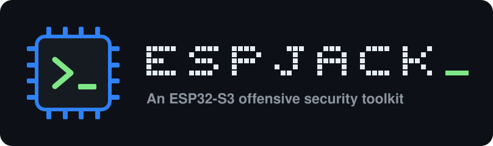
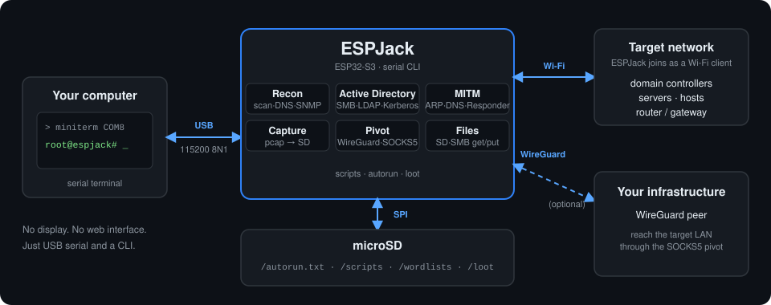

<h1 align="center">
  
</h1>

<p align="center">
  Network reconnaissance, Active Directory enumeration, traffic interception and pivoting, from a USB serial CLI.
</p>

<p align="center">
  
  
  <a href="https://github.com/XPSec-Security/espjack/wiki"></a>
  
</p>

ESPJack is a lightweight, command-line security toolkit designed for ESP32-S3 devices. Built for security research, penetration testing and authorized network assessments, it brings network reconnaissance, traffic interception, Active Directory enumeration and post-exploitation capabilities into a compact embedded platform.

No display. No web interface. Just a USB serial connection and a powerful CLI.

<p align="center">
  <a href="https://asciinema.org/a/k0zoHqj1mqaXl8ZM"></a><br>
  <sub>Click the animation to open the interactive recording on asciinema.</sub>
</p>

**[Features](#features) · [See it in action](#see-it-in-action) · [How it works](#how-it-works) · [Scope](#what-espjack-is-and-isnt) · [Hardware](#hardware-requirements) · [Install](#installation) · [Serial console](#serial-console) · [SD card](#sd-card-setup) · [Commands](#command-reference) · [Wiki](https://github.com/XPSec-Security/espjack/wiki)**

---

## Features

| Category | Capabilities |
|---|---|
| **Network** | Wi-Fi scanning, connection and network discovery |
| **Reconnaissance** | Host discovery, port scanning, DNS, SNMP and DHCP |
| **Active Directory** | SMB, LDAP, Kerberos, AS-REP Roasting and Kerberoasting |
| **MITM** | ARP spoofing, DNS spoofing and Responder |
| **Capture** | Network packet capture and PCAP export |
| **Pivoting** | WireGuard tunnel and SOCKS5 proxy |
| **File System** | File management, SMB transfers and SD card access |
| **Automation** | Scripts, payload execution and automatic startup |

## See it in action

### ARP spoofing with a transparent relay

`arpspoof on` finds every host on the local /24 and poisons them. The relay forwards the victims' traffic on, so they stay online while you watch the status.

<p align="center">
  <a href="https://asciinema.org/a/Z7C6JhGjBVaALP2I"></a><br>
  <sub>Click the animation to open the interactive recording on asciinema.</sub>
</p>

The gateway entry in a victim's ARP table, before and after: the router's MAC is replaced by the device's.

<p align="center">
  
</p>

### Authenticated SMB check

`smbrecon` shows which account it authenticated as and whether that account is a local administrator.

<p align="center">
  
</p>

## How it works

ESPJack runs directly on the ESP32-S3 and exposes a Linux-style command-line interface through its native USB serial connection.

<p align="center">
  
</p>

Getting started takes just a few steps:

1. Flash the firmware onto your ESP32-S3.
2. Connect the device to your computer via USB.
3. Open a serial terminal at `115200` baud.
4. Connect to a Wi-Fi network.
5. Start running commands.

```bash
wifi scan
wifi connect <ssid> <password>
help
```

ESPJack also supports scripts stored on the microSD card, including automatic execution at startup through `/autorun.txt`.

## What ESPJack is (and isn't)

ESPJack is a drop-and-pivot implant for networks you are authorized to assess: reconnaissance, Active Directory enumeration, credential capture and pivoting. It is deliberately narrow.

- **No Wi-Fi-layer attacks.** No deauthentication, evil twin or handshake capture. Use a dedicated tool such as [Bruce](https://github.com/pr3y/Bruce) for that.
- **No remote command execution.** The SMB features are enumeration, authentication and file access, not a way to run commands on a target.
- **No exfiltration channel.** ESPJack does not phone home: there is no cloud upload, webhook or wireless console. What it captures stays on the SD card until you collect it, for example by exporting the card with `mount`.

## Hardware Requirements

- ESP32-S3 development board.
- Native USB connection.
- microSD card (optional, required for storage-dependent features).

The firmware targets the generic `esp32-s3-devkitc-1` PlatformIO board definition and supports different ESP32-S3 development boards.

### microSD Configuration

The default SPI configuration follows the M5Stack Cardputer ADV wiring:

| Signal | GPIO |
|---|---:|
| CS | 12 |
| SCK | 40 |
| MISO | 39 |
| MOSI | 14 |
| Card enable | 5 |

Custom GPIO assignments can be configured without rebuilding the firmware.

See [SD Card Setup](#sd-card-setup) for details.

## Installation

### Build and Flash

ESPJack uses [PlatformIO](https://platformio.org/) for firmware development and deployment.

Clone the repository:

```bash
git clone https://github.com/XPSec-Security/espjack.git
cd espjack
```

Build and upload:

```bash
pio run -t upload
```

PlatformIO automatically installs the dependencies defined in `platformio.ini`.

If the upload cannot find the board, put it in bootloader mode (hold the BOOT button while plugging in the USB cable) and upload again. The serial port number can differ between the bootloader and the running firmware.

## Serial Console

ESPJack communicates through the ESP32-S3 native USB serial interface at `115200` baud, 8 data bits, no parity, 1 stop bit.

```bash
pip install pyserial

# Windows
python -m serial.tools.miniterm COM8 115200

# Linux / macOS
python -m serial.tools.miniterm /dev/ttyACM0 115200

# List the available serial ports
python -m serial.tools.list_ports
```

Once connected, you should see the ESPJack shell:

```text
root@espjack#
```

Use `Ctrl+C` to interrupt a running command and `Ctrl+]` to exit miniterm.

To leave without turning the device off, type `exit`. The USB console detaches, so your terminal closes and you are back at your shell, while the device and any background tasks (such as `arpspoof` or `responder`) keep running. Run miniterm again to reconnect. miniterm prints a short pyserial traceback when the port disappears; that is expected.

## SD Card Setup

The microSD card provides persistent storage for scripts, wordlists, packet captures and collected data.

### Directory Structure

```text
/
├── autorun.txt
├── scripts/
├── wordlists/
│   ├── users.txt
│   └── spns.txt
└── loot/
    ├── responder_ntlm.txt
    └── captures.pcap
```

Sample wordlists are available in:

```text
sd_card/wordlists/
```

Copy the desired `.example` files to `/wordlists/` and remove the `.example` extension.

The `/loot` directory is created automatically when a microSD card is detected.

### Device Settings

ESPJack stores device settings in its internal flash at `/settings.json`.

Examples:

```bash
settings show

settings set sd.cs 10
settings set sd.sck 12
settings set sd.miso 13
settings set sd.mosi 11

settings set hostname MyDevice
settings set mac AA:BB:CC:DD:EE:FF

settings reset
```

Changes to SD card GPIO assignments require a reboot.

### Autorun

ESPJack supports automatic command execution during startup.

Create `/autorun.txt` on the microSD card:

```bash
wifi connect <ssid> <password>
delay 3000
arpspoof on
responder on
pcap start sweep
```

The autorun process starts approximately three seconds after boot. Press `Ctrl+C` during this window to cancel execution.

## Command Reference

ESPJack provides a collection of tools organized into functional categories. Each command links to its page in the wiki.

| Category | Commands |
|---|---|
| **Network** | [`wifi`](https://github.com/XPSec-Security/espjack/wiki/wifi), [`download`](https://github.com/XPSec-Security/espjack/wiki/download) |
| **Reconnaissance** | [`portscan`](https://github.com/XPSec-Security/espjack/wiki/portscan), [`hostscan`](https://github.com/XPSec-Security/espjack/wiki/hostscan), [`arpscan`](https://github.com/XPSec-Security/espjack/wiki/arpscan), [`nbtscan`](https://github.com/XPSec-Security/espjack/wiki/nbtscan), [`nslookup`](https://github.com/XPSec-Security/espjack/wiki/nslookup), [`discover`](https://github.com/XPSec-Security/espjack/wiki/discover), [`snmp`](https://github.com/XPSec-Security/espjack/wiki/snmp), [`dhcp`](https://github.com/XPSec-Security/espjack/wiki/dhcp) |
| **Active Directory** | [`smbrecon`](https://github.com/XPSec-Security/espjack/wiki/smbrecon), [`smbshares`](https://github.com/XPSec-Security/espjack/wiki/smbshares), [`ldaprecon`](https://github.com/XPSec-Security/espjack/wiki/ldaprecon), [`kerbrute`](https://github.com/XPSec-Security/espjack/wiki/kerbrute), [`asreproast`](https://github.com/XPSec-Security/espjack/wiki/asreproast), [`kerberoast`](https://github.com/XPSec-Security/espjack/wiki/kerberoast) |
| **MITM & Poisoning** | [`arpspoof`](https://github.com/XPSec-Security/espjack/wiki/arpspoof), [`responder`](https://github.com/XPSec-Security/espjack/wiki/responder), [`dnsspoof`](https://github.com/XPSec-Security/espjack/wiki/dnsspoof) |
| **Capture** | [`pcap`](https://github.com/XPSec-Security/espjack/wiki/pcap) |
| **Pivoting** | [`wireguard`](https://github.com/XPSec-Security/espjack/wiki/wireguard), [`socks5`](https://github.com/XPSec-Security/espjack/wiki/socks5) |
| **File Management** | [`ls`](https://github.com/XPSec-Security/espjack/wiki/ls), [`cat`](https://github.com/XPSec-Security/espjack/wiki/cat), [`echo`](https://github.com/XPSec-Security/espjack/wiki/echo), [`rm`](https://github.com/XPSec-Security/espjack/wiki/rm), [`mkdir`](https://github.com/XPSec-Security/espjack/wiki/mkdir), [`rmdir`](https://github.com/XPSec-Security/espjack/wiki/rmdir), [`mv`](https://github.com/XPSec-Security/espjack/wiki/mv), [`cp`](https://github.com/XPSec-Security/espjack/wiki/cp), [`get`](https://github.com/XPSec-Security/espjack/wiki/get), [`put`](https://github.com/XPSec-Security/espjack/wiki/put), [`stat`](https://github.com/XPSec-Security/espjack/wiki/stat), [`df`](https://github.com/XPSec-Security/espjack/wiki/df) |
| **System** | [`help`](https://github.com/XPSec-Security/espjack/wiki/help), [`settings`](https://github.com/XPSec-Security/espjack/wiki/settings), [`run`](https://github.com/XPSec-Security/espjack/wiki/run), [`delay`](https://github.com/XPSec-Security/espjack/wiki/delay), [`loot`](https://github.com/XPSec-Security/espjack/wiki/loot), [`date`](https://github.com/XPSec-Security/espjack/wiki/date), [`mount`](https://github.com/XPSec-Security/espjack/wiki/mount), [`unmount`](https://github.com/XPSec-Security/espjack/wiki/unmount), [`clear`](https://github.com/XPSec-Security/espjack/wiki/clear), [`exit`](https://github.com/XPSec-Security/espjack/wiki/exit), [`reboot`](https://github.com/XPSec-Security/espjack/wiki/reboot) |

For a complete command reference, run:

```bash
help
```

To display the usage and available options for a specific command:

```bash
<command> -h
```

Or:

```bash
help <command>
```

Visit the [ESPJack Wiki](https://github.com/XPSec-Security/espjack/wiki) for detailed documentation and usage examples.

## Technical Notes & Limitations

ESPJack is designed around the capabilities and constraints of the ESP32-S3 platform.

- **Scanning:** TCP connect with banner and version detection by default. `portscan -s` runs a half-open SYN scan over a raw socket: it reports open, closed and filtered ports, but no banner or version.
- **Protocol implementations:** SMB2, LDAP, Kerberos and SOCKS5 are lightweight, custom implementations focused on the functionality required by the toolkit.
- **ARP spoofing:** Uses a custom Layer 2 relay to keep intercepted devices connected during authorized testing.
- **SOCKS5:** Supports CONNECT only. BIND and UDP ASSOCIATE are not implemented.
- **Concurrent connections:** Limited by the ESP32-S3 networking stack and available socket resources.
- **Kerberoasting:** Experimental implementation using RC4-HMAC Kerberos cryptography.
- **AS-REP Roasting:** Does not require password decryption to retrieve the relevant authentication material.

Performance and compatibility may vary depending on the target network, hardware and server configuration.

## Security & Responsible Use

ESPJack includes active security testing and network interception capabilities.

It is intended exclusively for:

- Authorized penetration testing.
- Security research and education.
- Controlled laboratory environments.
- Networks and systems you own or have explicit permission to assess.

**Never use ESPJack against systems or networks without proper authorization.**

The user is responsible for complying with applicable laws, regulations and engagement scopes.

## Documentation

For detailed guides, command references and configuration instructions:

**[ESPJack Wiki](https://github.com/XPSec-Security/espjack/wiki)**

## License

See the repository for licensing information.

---

**ESPJack** · Developed by [XPSec Security](https://github.com/XPSec-Security)
